<!-- GENERATED by tools/ui-docs.mjs from spec/ui/*.yaml. Do not edit by hand. -->

# Navigation map

Every navigation edge in the UI spec. Solid arrows: links and buttons (`go`). Views (`#name`) are drawers, modals or panes on their screen. Nodes outside the module are drawn with a dashed border. Global navigation (rail, top bar, chart nav, section tabs, folders) is listed first and omitted from the module diagrams to keep them readable.

## Global navigation

### Left rail by role

| Rail item | Front desk | MA / nurse | Provider | Biller | Practice manager |
|---|---|---|---|---|---|
| Home | `home.frontdesk-board` | `home.clinical-daylist` | `home.provider-worklist` | `home.rcm-queues` | `home.practice-kpis` |
| Schedule | `schedule.calendar` | `schedule.calendar` | `schedule.calendar` | `schedule.calendar` | `schedule.calendar` |
| Patients | `patients.search` | `patients.search` | `patients.search` | `patients.search` | `patients.search` |
| Inbox | `inbox.previsit-queue` | `inbox.patient-messages` | `inbox.results` | `inbox.tasks` | `inbox.tasks` |
| Billing | `billing.eligibility` | — | — | `billing.charge-review` | `billing.day-close` |
| Reports | `reports.no-shows` | `reports.care-gaps` | `reports.quality` | `reports.ar-aging` | `reports.quality` |
| Telehealth | — | `telehealth.waiting-room` | `telehealth.waiting-room` | — | — |
| Admin | — | — | — | — | `admin.users-roles` |

### Top bar

- **practice-name** → _no navigation_
- **Location** → _no navigation_
- **Search patients, screens, actions (⌘K)** → `global.command-bar`
- **Notifications** → `global.notifications`
- **inbox-count** → `inbox.previsit-queue`, `inbox.patient-messages`, `inbox.results`, `inbox.tasks`
- **Account security** → `auth.account-security`
- **User** → _switch active role; preferences; sign out_

### Inbox folders

- **Pool** → _no navigation_
- **Results** → `inbox.results` _(when role ma or provider)_
- **Rx requests** → `inbox.rx-requests` _(when role ma or provider)_
- **Co-sign** → `inbox.cosign` _(when role provider)_
- **Patient messages** → `inbox.patient-messages`
- **Tasks** → `inbox.tasks`
- **Pre-visit changes** → `inbox.previsit-queue` _(when role frontdesk or ma)_
- **Documents** → `inbox.documents` _(when role frontdesk or ma)_
- **Prior auth** → `inbox.prior-auth` _(when role frontdesk or ma)_
- **Specimen collection** → `orders.collection` _(when role ma)_
- **Overdue orders** → `orders.tracking` _(when role ma or provider)_
- **Unmatched results** → `orders.result-reconciliation` _(when role ma or manager)_
- **Referrals** → `referrals.worklist` _(when role frontdesk)_

### Schedule tabs

- **Calendar** → `schedule.calendar`
- **Flow board** → `schedule.flow-board`
- **Rooms** → `schedule.room-board`
- **Waitlist** → `schedule.waitlist`
- **Recalls** → `schedule.recall-list`

### Billing tabs

- **Eligibility** → `billing.eligibility`
- **Estimates** → `billing.estimates`
- **Payments** → `billing.payment-capture`
- **Charge review** → `billing.charge-review`
- **Claims** → `billing.claims`
- **Rejections** → `billing.rejections`
- **ERA posting** → `billing.era-posting`
- **Denials** → `billing.denials`
- **Statements** → `billing.statements`
- **Patient accounts** → `billing.patient-account`
- **Day close** → `billing.day-close`

### Report navigation

- **AR aging** → `reports.ar-aging`
- **Collections & payer mix** → `reports.collections`
- **Charge lag** → `reports.charge-lag`
- **No-shows & fill rate** → `reports.no-shows`
- **Visit cycle time** → `reports.cycle-time`
- **Provider productivity** → `reports.productivity`
- **Quality measures** → `reports.quality`
- **Care gaps by panel** → `reports.care-gaps`
- **Data export** → `reports.export`

### Admin navigation

- **Practice & locations** → `admin.locations`
- **Users & roles** → `admin.users-roles`
- **Providers** → `admin.providers`
- **Visit types** → `admin.visit-types`
- **Online booking** → `admin.online-booking`
- **Payers & fees** → `admin.payers-fees`
- **Templates** → `admin.templates`
- **Order sets** → `admin.order-sets`
- **Forms** → `admin.forms`
- **Alert rules** → `admin.cds-rules`
- **Security policy** → `admin.security`
- **Audit log** → `admin.audit-log`
- **Interfaces** → `admin.interfaces`
- **Portal settings** → `admin.portal-settings`

### Patients tabs

- **Search** → `patients.search`
- **Lists & panels** → `patients.lists`
- **Registries** → `patients.registries`
- **Duplicates** → `patients.merge-review` _(when role manager)_

### Portal tabs

- **Home** → `portal.home`
- **Visits** → `portal.appointments`
- **Messages** → `portal.messages`
- **Health record** → `portal.record`
- **Billing** → `portal.billing`

### Chart navigation and encounter tabs

Every chart screen has the chart nav (19 links to each chart section). Every encounter screen has section tabs: `encounter.prechart` → `encounter.rooming` → `encounter.note` → `encounter.orders` → `encounter.rx` → `encounter.dx-coding` → `encounter.charges` → `encounter.avs` → `encounter.sign`.

### Rules

- **NAV-01** Every route is deep-linkable and survives refresh. Browser back pops history.
- **NAV-02** The Up link (breadcrumb, back-to-list link) goes to the screen's `up`, keeping that screen's last filters and scroll.
- **NAV-03** Views (drawer, modal, pane) close back to the underlying view. A view has its own URL fragment (e.g. ?view=arrive) so it can be linked and survives refresh.
- **NAV-04** Any patient link opens the chart context (/patient/:patientId/summary) as a chart tab. Opening a second patient adds a tab, up to OPEN-Q9; the oldest unpinned tab closes first. Closing the last chart tab returns to the last non-chart route.
- **NAV-05** Encounter section tabs are sibling routes under /patient/:patientId/encounter/:encounterId/. Leaving keeps the draft; the encounter stays reachable from the chart tab and the provider worklist.
- **NAV-06** Blocking modals (alerts, pre-sign checks) cannot be dismissed with Esc or scrim click; the user picks an action.
- **NAV-07** Navigating away from a form with unsaved, non-autosaved changes asks to keep editing or discard.
- **NAV-08** The command bar (⌘K / Ctrl+K) can open any patient, any screen the role may see, and named actions (Book, New patient, New message).
- **NAV-09** Rail and folder items a role cannot use are hidden, not disabled. Deep links to them show permission-denied.
- **NAV-10** Session timeout returns to sign-in and then to the same route with drafts restored (INV-SEC-04).

## Home (`home`)

Role-specific work queues. Every tile is a filtered list with a count and a primary action (ADR-007).

```mermaid
flowchart LR
  home_frontdesk_board["home.frontdesk-board"]
  home_frontdesk_board_arrive["home.frontdesk-board › arrive"]
  home_clinical_daylist["home.clinical-daylist"]
  home_provider_worklist["home.provider-worklist"]
  home_rcm_queues["home.rcm-queues"]
  home_practice_kpis["home.practice-kpis"]
  global_command_bar["global.command-bar"]
  global_notifications["global.notifications"]
  schedule_booking_drawer["schedule.booking-drawer"]:::ext
  admin_interfaces["admin.interfaces"]:::ext
  chart_summary["chart.summary"]:::ext
  chart_demographics["chart.demographics"]:::ext
  schedule_appointment_detail["schedule.appointment-detail"]:::ext
  inbox_previsit_queue["inbox.previsit-queue"]:::ext
  schedule_waitlist["schedule.waitlist"]:::ext
  schedule_calendar["schedule.calendar"]:::ext
  chart_demographics_coverage["chart.demographics › coverage"]:::ext
  schedule_flow_board_room["schedule.flow-board › room"]:::ext
  encounter_rooming["encounter.rooming"]:::ext
  inbox_patient_messages["inbox.patient-messages"]:::ext
  inbox_rx_requests["inbox.rx-requests"]:::ext
  orders_collection["orders.collection"]:::ext
  schedule_recall_list["schedule.recall-list"]:::ext
  schedule_flow_board["schedule.flow-board"]:::ext
  encounter_prechart["encounter.prechart"]:::ext
  encounter_note["encounter.note"]:::ext
  inbox_results["inbox.results"]:::ext
  inbox_cosign["inbox.cosign"]:::ext
  billing_charge_review["billing.charge-review"]:::ext
  billing_rejections["billing.rejections"]:::ext
  billing_era_posting["billing.era-posting"]:::ext
  billing_denials["billing.denials"]:::ext
  billing_claims["billing.claims"]:::ext
  billing_day_close["billing.day-close"]:::ext
  reports_ar_aging["reports.ar-aging"]:::ext
  reports_productivity["reports.productivity"]:::ext
  reports_no_shows["reports.no-shows"]:::ext
  reports_cycle_time["reports.cycle-time"]:::ext
  reports_charge_lag["reports.charge-lag"]:::ext
  reports_quality["reports.quality"]:::ext
  admin_audit_log["admin.audit-log"]:::ext
  patients_merge_review["patients.merge-review"]:::ext
  patients_registration["patients.registration"]:::ext
  inbox_tasks_new["inbox.tasks › new"]:::ext
  inbox_tasks["inbox.tasks"]:::ext
  global_command_bar --> chart_summary
  global_command_bar --> inbox_tasks_new
  global_command_bar --> patients_registration
  global_command_bar --> schedule_booking_drawer
  global_notifications --> inbox_results
  global_notifications --> inbox_tasks
  home_clinical_daylist --> chart_summary
  home_clinical_daylist --> encounter_rooming
  home_clinical_daylist --> inbox_patient_messages
  home_clinical_daylist --> inbox_rx_requests
  home_clinical_daylist --> orders_collection
  home_clinical_daylist --> schedule_flow_board
  home_clinical_daylist --> schedule_flow_board_room
  home_clinical_daylist --> schedule_recall_list
  home_frontdesk_board --> admin_interfaces
  home_frontdesk_board --> chart_demographics
  home_frontdesk_board --> chart_summary
  home_frontdesk_board --> home_frontdesk_board_arrive
  home_frontdesk_board --> inbox_previsit_queue
  home_frontdesk_board --> schedule_appointment_detail
  home_frontdesk_board --> schedule_booking_drawer
  home_frontdesk_board --> schedule_calendar
  home_frontdesk_board --> schedule_waitlist
  home_frontdesk_board_arrive --> chart_demographics_coverage
  home_practice_kpis --> admin_audit_log
  home_practice_kpis --> admin_interfaces
  home_practice_kpis --> patients_merge_review
  home_practice_kpis --> reports_ar_aging
  home_practice_kpis --> reports_charge_lag
  home_practice_kpis --> reports_cycle_time
  home_practice_kpis --> reports_no_shows
  home_practice_kpis --> reports_productivity
  home_practice_kpis --> reports_quality
  home_provider_worklist --> chart_summary
  home_provider_worklist --> encounter_note
  home_provider_worklist --> encounter_prechart
  home_provider_worklist --> inbox_cosign
  home_provider_worklist --> inbox_patient_messages
  home_provider_worklist --> inbox_results
  home_provider_worklist --> inbox_rx_requests
  home_rcm_queues --> billing_charge_review
  home_rcm_queues --> billing_claims
  home_rcm_queues --> billing_day_close
  home_rcm_queues --> billing_denials
  home_rcm_queues --> billing_era_posting
  home_rcm_queues --> billing_rejections
  home_rcm_queues --> reports_ar_aging
  classDef ext stroke-dasharray: 4 3,fill:#f4f4f2;
```

| Screen | Route | Up | Views | Reached from |
|---|---|---|---|---|
| `home.frontdesk-board` | `/home/front-desk` | — | #arrive | global nav, `auth.mfa-challenge`, `auth.mfa-enroll`, `schedule.appointment-detail` |
| `home.clinical-daylist` | `/home/clinical` | — | — | global nav, `auth.mfa-challenge`, `auth.mfa-enroll` |
| `home.provider-worklist` | `/home/provider` | — | — | global nav, `auth.mfa-challenge`, `auth.mfa-enroll`, `encounter.sign` |
| `home.rcm-queues` | `/home/billing` | — | — | global nav, `auth.mfa-challenge`, `auth.mfa-enroll` |
| `home.practice-kpis` | `/home/practice` | — | — | global nav, `auth.mfa-challenge`, `auth.mfa-enroll` |
| `global.command-bar` | _overlay_ | — | — | global nav |
| `global.notifications` | _overlay_ | — | — | global nav |

## Schedule (`schedule`)

Plan and run the day. Booking is a drawer over the calendar so context is never lost.

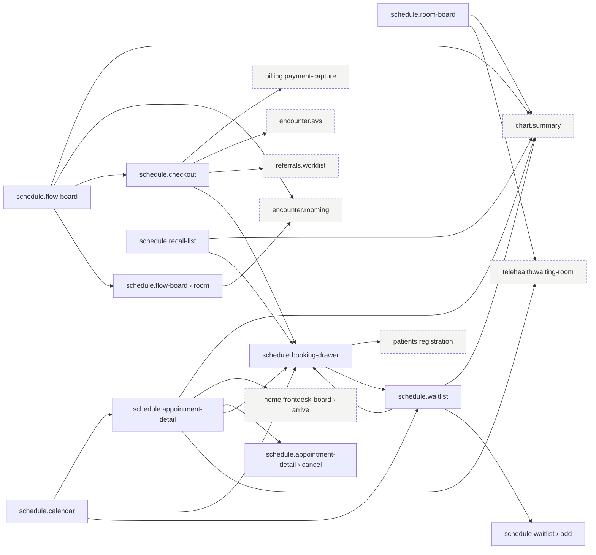

| Screen | Route | Up | Views | Reached from |
|---|---|---|---|---|
| `schedule.calendar` | `/schedule` | — | — | global nav, `home.frontdesk-board` |
| `schedule.booking-drawer` | `/schedule/book` | `schedule.calendar` | — | `chart.summary`, `global.command-bar`, `home.frontdesk-board`, `inbox.patient-messages`, `inbox.results`, `inbox.rx-requests`, `patients.registration`, `patients.search`, `reports.no-shows`, `schedule.appointment-detail`, `schedule.calendar`, `schedule.checkout`, `schedule.recall-list`, `schedule.waitlist`, `telehealth.evisit` |
| `schedule.appointment-detail` | `/schedule/appointments/:appointmentId` | `schedule.calendar` | #cancel | `home.frontdesk-board`, `schedule.calendar` |
| `schedule.flow-board` | `/schedule/flow` | `schedule.calendar` | #room | global nav, `home.clinical-daylist` |
| `schedule.room-board` | `/schedule/rooms` | `schedule.flow-board` | — | global nav |
| `schedule.checkout` | `/schedule/checkout/:appointmentId` | `schedule.flow-board` | — | `schedule.flow-board` |
| `schedule.waitlist` | `/schedule/waitlist` | `schedule.calendar` | #add | global nav, `home.frontdesk-board`, `schedule.booking-drawer`, `schedule.calendar` |
| `schedule.recall-list` | `/schedule/recalls` | `schedule.calendar` | — | global nav, `home.clinical-daylist`, `patients.registries`, `reports.care-gaps`, `reports.quality` |

## Patients (`patients`)

Find or create a patient, then open the chart context. Duplicate prevention starts here.

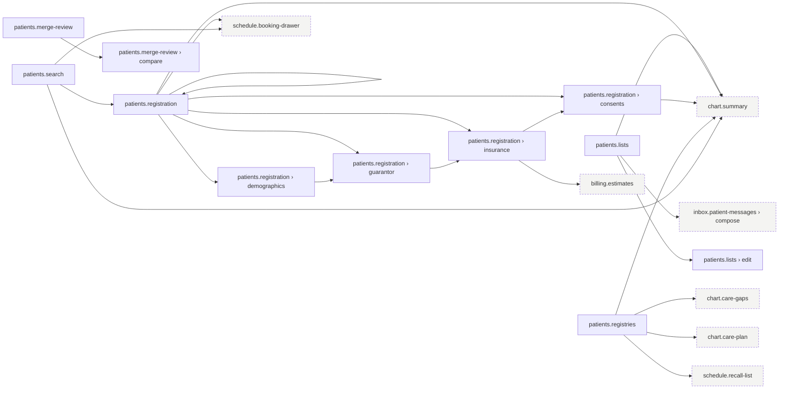

| Screen | Route | Up | Views | Reached from |
|---|---|---|---|---|
| `patients.search` | `/patients` | — | — | global nav |
| `patients.registration` | `/patients/new` | `patients.search` | #demographics, #guarantor, #insurance, #consents | `global.command-bar`, `patients.search`, `schedule.booking-drawer` |
| `patients.merge-review` | `/patients/duplicates` | `patients.search` | #compare | global nav, `home.practice-kpis` |
| `patients.lists` | `/patients/lists` | `patients.search` | #edit | global nav |
| `patients.registries` | `/patients/registries` | `patients.search` | — | global nav |

## Patient chart (`chart`)

Everything about one patient. Pinned banner (INV-ID-01). Opened from anywhere.

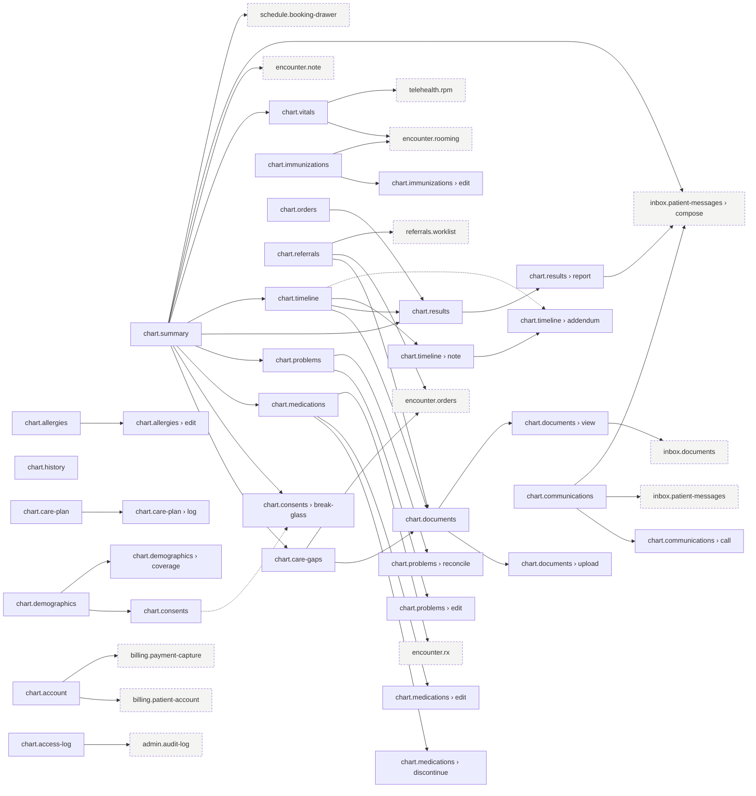

| Screen | Route | Up | Views | Reached from |
|---|---|---|---|---|
| `chart.summary` | `/patient/:patientId/summary` | — | — | global nav, `global.command-bar`, `home.clinical-daylist`, `home.frontdesk-board`, `home.provider-worklist`, `inbox.patient-messages`, `patients.lists`, `patients.registration`, `patients.registries`, `patients.search`, `reports.cycle-time`, `reports.no-shows`, `schedule.appointment-detail`, `schedule.flow-board`, `schedule.recall-list`, `schedule.room-board`, `schedule.waitlist`, `telehealth.waiting-room` |
| `chart.timeline` | `/patient/:patientId/timeline` | `chart.summary` | #note, #addendum | global nav, `chart.summary` |
| `chart.problems` | `/patient/:patientId/problems` | `chart.summary` | #edit, #reconcile | global nav, `chart.summary` |
| `chart.medications` | `/patient/:patientId/medications` | `chart.summary` | #edit, #discontinue | global nav, `chart.summary`, `encounter.rooming`, `inbox.previsit-queue` |
| `chart.allergies` | `/patient/:patientId/allergies` | `chart.summary` | #edit | global nav, `encounter.rooming` |
| `chart.vitals` | `/patient/:patientId/vitals` | `chart.summary` | — | global nav, `chart.summary`, `telehealth.rpm` |
| `chart.results` | `/patient/:patientId/results` | `chart.summary` | #report | global nav, `chart.orders`, `chart.summary`, `chart.timeline`, `inbox.results` |
| `chart.immunizations` | `/patient/:patientId/immunizations` | `chart.summary` | #edit | global nav |
| `chart.history` | `/patient/:patientId/history` | `chart.summary` | — | global nav |
| `chart.orders` | `/patient/:patientId/orders` | `chart.summary` | — | global nav, `inbox.results` |
| `chart.referrals` | `/patient/:patientId/referrals` | `chart.summary` | — | global nav |
| `chart.care-plan` | `/patient/:patientId/care-plan` | `chart.summary` | #log | global nav, `patients.registries`, `telehealth.rpm` |
| `chart.care-gaps` | `/patient/:patientId/care-gaps` | `chart.summary` | — | global nav, `chart.summary`, `patients.registries`, `reports.care-gaps`, `reports.quality` |
| `chart.documents` | `/patient/:patientId/documents` | `chart.summary` | #view, #upload | global nav, `chart.care-gaps`, `chart.referrals`, `chart.timeline` |
| `chart.communications` | `/patient/:patientId/communications` | `chart.summary` | #call | global nav, `inbox.patient-messages` |
| `chart.demographics` | `/patient/:patientId/demographics` | `chart.summary` | #coverage | global nav, `billing.eligibility`, `billing.rejections`, `home.frontdesk-board` |
| `chart.consents` | `/patient/:patientId/consents` | `chart.summary` | #break-glass | global nav, `chart.demographics`, `chart.summary` |
| `chart.account` | `/patient/:patientId/account` | `chart.summary` | — | global nav |
| `chart.access-log` | `/patient/:patientId/access-log` | `chart.summary` | — | global nav |

## Encounter workspace (`encounter`)

One visit's documentation, orders, prescriptions, coding and signing.

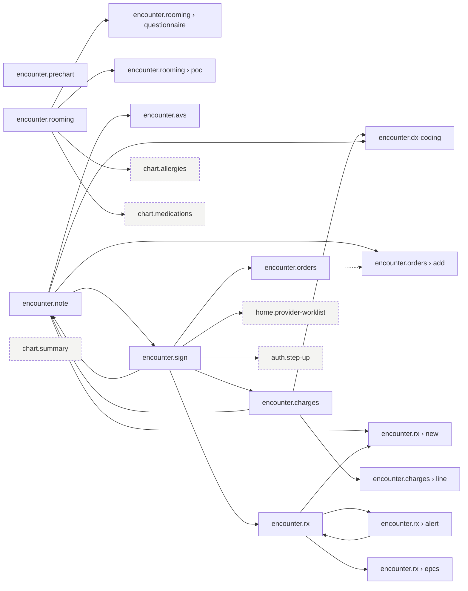

| Screen | Route | Up | Views | Reached from |
|---|---|---|---|---|
| `encounter.prechart` | `/patient/:patientId/encounter/:encounterId/prechart` | `chart.summary` | — | global nav, `home.provider-worklist` |
| `encounter.rooming` | `/patient/:patientId/encounter/:encounterId/rooming` | `chart.summary` | #questionnaire, #poc | global nav, `chart.immunizations`, `chart.vitals`, `home.clinical-daylist`, `schedule.flow-board` |
| `encounter.note` | `/patient/:patientId/encounter/:encounterId/note` | `chart.summary` | — | global nav, `chart.summary`, `encounter.charges`, `encounter.sign`, `home.provider-worklist`, `inbox.cosign`, `telehealth.visit` |
| `encounter.orders` | `/patient/:patientId/encounter/:encounterId/orders` | `encounter.note` | #add | global nav, `chart.care-gaps`, `chart.referrals`, `encounter.note`, `encounter.sign`, `telehealth.evisit` |
| `encounter.rx` | `/patient/:patientId/encounter/:encounterId/rx` | `encounter.note` | #new, #alert, #epcs | global nav, `chart.medications`, `encounter.note`, `encounter.sign`, `inbox.rx-requests` |
| `encounter.dx-coding` | `/patient/:patientId/encounter/:encounterId/dx` | `encounter.note` | — | global nav, `encounter.charges`, `encounter.note` |
| `encounter.charges` | `/patient/:patientId/encounter/:encounterId/charges` | `encounter.note` | #line | global nav, `encounter.sign` |
| `encounter.avs` | `/patient/:patientId/encounter/:encounterId/avs` | `encounter.note` | — | global nav, `encounter.note`, `schedule.checkout` |
| `encounter.sign` | `/patient/:patientId/encounter/:encounterId/sign` | `encounter.note` | — | global nav, `encounter.note` |

## Inbox (`inbox`)

Single work queue with typed folders and pools. Every item has an owner, due time and audit trail.

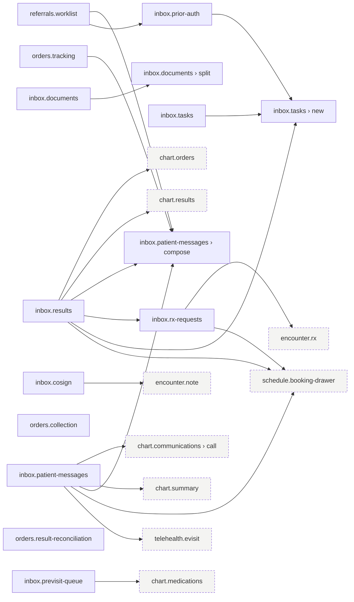

| Screen | Route | Up | Views | Reached from |
|---|---|---|---|---|
| `inbox.results` | `/inbox/results` | — | — | global nav, `global.notifications`, `home.provider-worklist` |
| `inbox.rx-requests` | `/inbox/rx-requests` | — | — | global nav, `home.clinical-daylist`, `home.provider-worklist`, `inbox.results` |
| `inbox.cosign` | `/inbox/cosign` | — | — | global nav, `home.provider-worklist` |
| `inbox.patient-messages` | `/inbox/messages` | — | #compose | global nav, `chart.communications`, `chart.results`, `chart.summary`, `home.clinical-daylist`, `home.provider-worklist`, `inbox.results`, `orders.tracking`, `patients.lists`, `referrals.worklist` |
| `inbox.tasks` | `/inbox/tasks` | — | #new | global nav, `billing.charge-review`, `global.command-bar`, `global.notifications`, `inbox.prior-auth`, `inbox.results` |
| `inbox.previsit-queue` | `/inbox/previsit` | — | — | global nav, `home.frontdesk-board` |
| `inbox.documents` | `/inbox/documents` | — | #split | global nav, `chart.documents` |
| `inbox.prior-auth` | `/inbox/prior-auth` | — | — | global nav, `referrals.worklist` |
| `orders.collection` | `/inbox/collection` | — | — | global nav, `home.clinical-daylist` |
| `orders.tracking` | `/inbox/overdue-orders` | — | — | global nav |
| `orders.result-reconciliation` | `/inbox/unmatched-results` | — | — | global nav |
| `referrals.worklist` | `/inbox/referrals` | — | — | global nav, `chart.referrals`, `schedule.checkout` |

## Billing (`billing`)

Practice management and revenue cycle, as worklists in the order money flows.

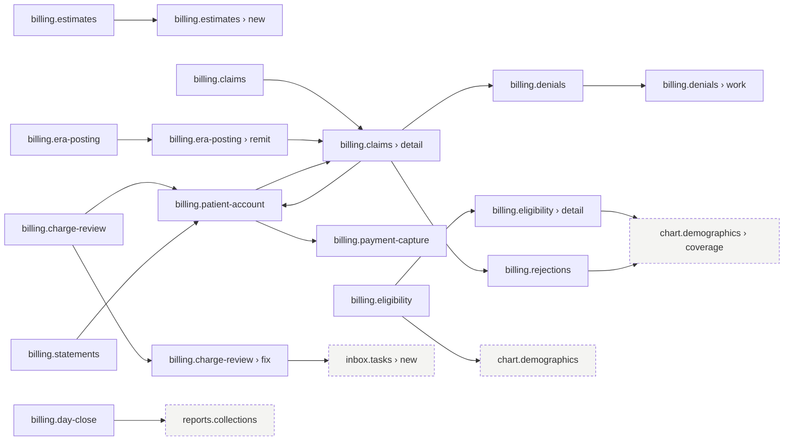

| Screen | Route | Up | Views | Reached from |
|---|---|---|---|---|
| `billing.eligibility` | `/billing/eligibility` | — | #detail | global nav |
| `billing.estimates` | `/billing/estimates` | `billing.eligibility` | #new | global nav, `patients.registration` |
| `billing.payment-capture` | `/billing/payments` | — | — | global nav, `billing.patient-account`, `chart.account`, `schedule.checkout` |
| `billing.charge-review` | `/billing/charge-review` | — | #fix | global nav, `home.rcm-queues`, `reports.charge-lag` |
| `billing.claims` | `/billing/claims` | — | #detail | global nav, `billing.era-posting`, `billing.patient-account`, `home.rcm-queues`, `reports.ar-aging` |
| `billing.rejections` | `/billing/rejections` | `billing.claims` | — | global nav, `billing.claims`, `home.rcm-queues` |
| `billing.era-posting` | `/billing/era` | — | #remit | global nav, `home.rcm-queues` |
| `billing.denials` | `/billing/denials` | — | #work | global nav, `billing.claims`, `home.rcm-queues` |
| `billing.statements` | `/billing/statements` | — | — | global nav |
| `billing.patient-account` | `/billing/accounts/:patientId` | `billing.statements` | — | global nav, `billing.charge-review`, `billing.claims`, `billing.statements`, `chart.account`, `reports.ar-aging`, `reports.collections` |
| `billing.day-close` | `/billing/day-close` | — | — | global nav, `home.rcm-queues` |

## Reports (`reports`)

Standard reports per role. Every number drills down to the records behind it.

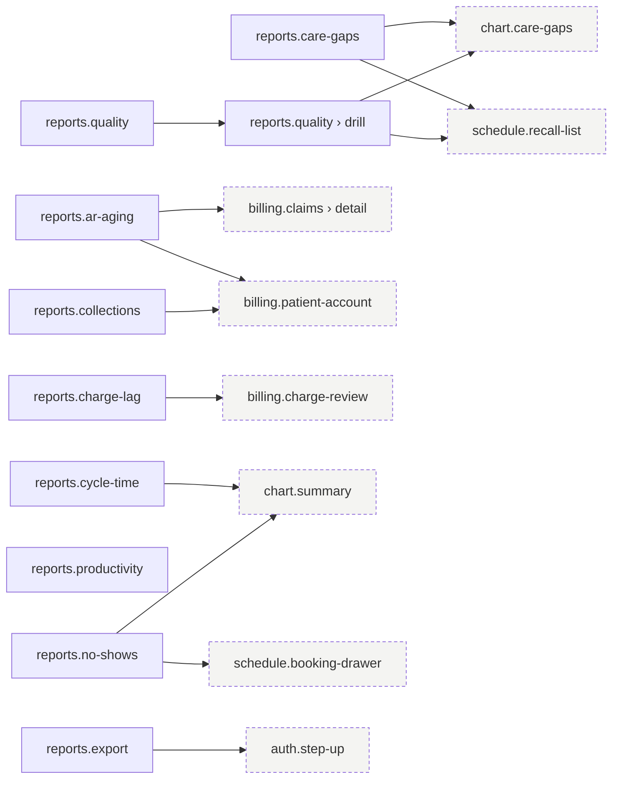

| Screen | Route | Up | Views | Reached from |
|---|---|---|---|---|
| `reports.ar-aging` | `/reports/ar-aging` | — | — | global nav, `home.practice-kpis`, `home.rcm-queues` |
| `reports.collections` | `/reports/collections` | — | — | global nav, `billing.day-close` |
| `reports.charge-lag` | `/reports/charge-lag` | — | — | global nav, `home.practice-kpis` |
| `reports.no-shows` | `/reports/no-shows` | — | — | global nav, `home.practice-kpis` |
| `reports.cycle-time` | `/reports/cycle-time` | — | — | global nav, `home.practice-kpis` |
| `reports.productivity` | `/reports/productivity` | — | — | global nav, `home.practice-kpis` |
| `reports.quality` | `/reports/quality` | — | #drill | global nav, `home.practice-kpis` |
| `reports.care-gaps` | `/reports/care-gaps` | — | — | global nav |
| `reports.export` | `/reports/export` | — | — | global nav |

## Telehealth (`telehealth`)

A modality of the same encounter (ADR-006), plus asynchronous care.

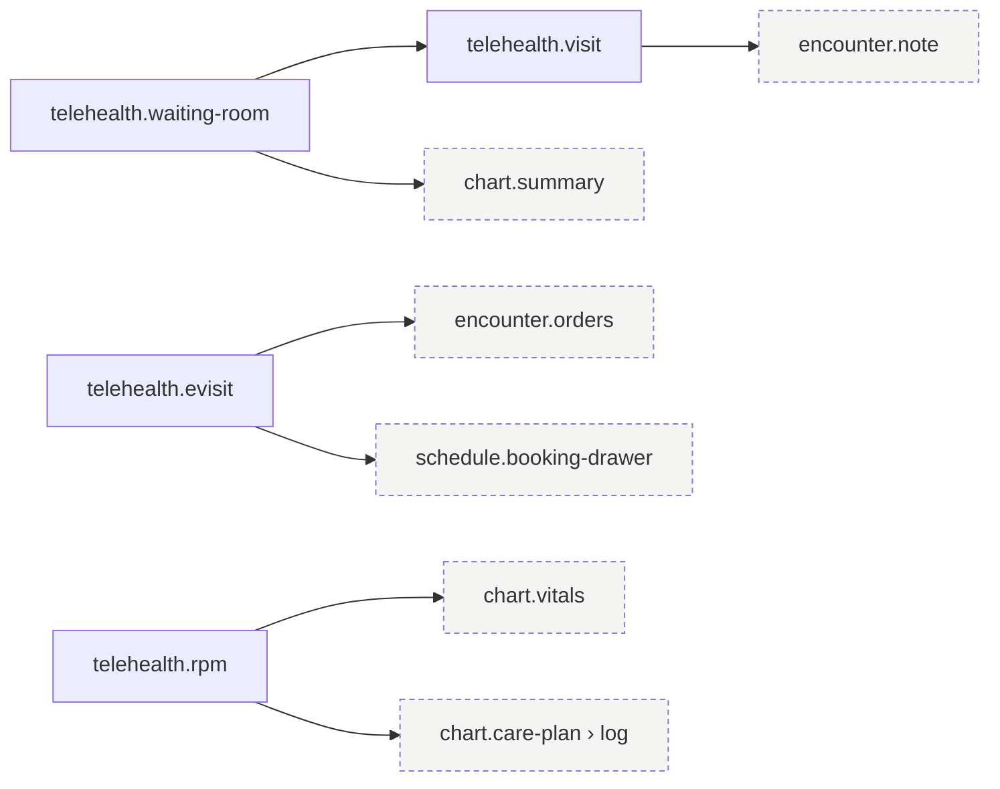

| Screen | Route | Up | Views | Reached from |
|---|---|---|---|---|
| `telehealth.waiting-room` | `/telehealth` | — | — | global nav, `portal.appointments`, `schedule.appointment-detail`, `schedule.room-board` |
| `telehealth.visit` | `/telehealth/visit/:appointmentId` | `telehealth.waiting-room` | — | `telehealth.waiting-room` |
| `telehealth.evisit` | `/telehealth/evisits` | `telehealth.waiting-room` | — | `inbox.patient-messages` |
| `telehealth.rpm` | `/telehealth/rpm` | `telehealth.waiting-room` | — | `chart.vitals` |

## Admin (`admin`)

Practice-owned configuration. Versioned and audited.

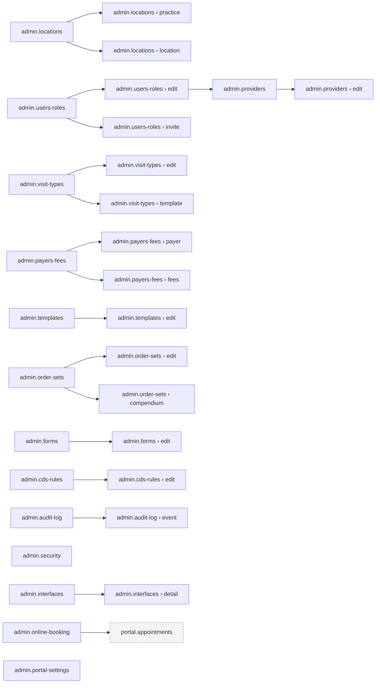

| Screen | Route | Up | Views | Reached from |
|---|---|---|---|---|
| `admin.locations` | `/admin/locations` | — | #practice, #location | global nav |
| `admin.users-roles` | `/admin/users` | — | #edit, #invite | global nav |
| `admin.providers` | `/admin/providers` | `admin.users-roles` | #edit | global nav, `admin.users-roles` |
| `admin.visit-types` | `/admin/visit-types` | — | #edit, #template | global nav |
| `admin.online-booking` | `/admin/online-booking` | `admin.visit-types` | — | global nav |
| `admin.payers-fees` | `/admin/payers` | — | #payer, #fees | global nav |
| `admin.templates` | `/admin/templates` | — | #edit | global nav |
| `admin.order-sets` | `/admin/order-sets` | — | #edit, #compendium | global nav |
| `admin.forms` | `/admin/forms` | — | #edit | global nav |
| `admin.cds-rules` | `/admin/alert-rules` | — | #edit | global nav |
| `admin.security` | `/admin/security` | — | — | global nav |
| `admin.audit-log` | `/admin/audit` | — | #event | global nav, `chart.access-log`, `home.practice-kpis` |
| `admin.interfaces` | `/admin/interfaces` | — | #detail | global nav, `home.frontdesk-board`, `home.practice-kpis` |
| `admin.portal-settings` | `/admin/portal` | — | — | global nav |

## Patient portal (`portal`)

Mobile-first, plain language, WCAG 2.1 AA. Proxy access for caregivers.

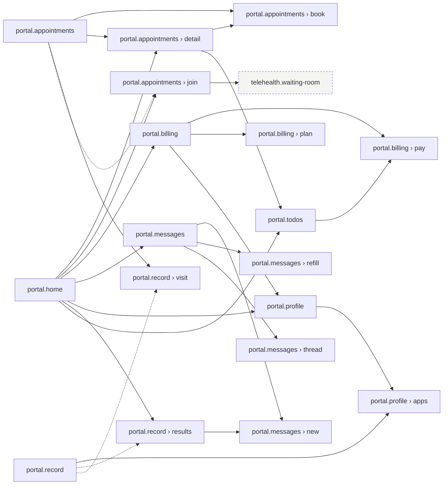

| Screen | Route | Up | Views | Reached from |
|---|---|---|---|---|
| `portal.home` | `/portal` | — | — | global nav, `portal.activate`, `portal.mfa-challenge` |
| `portal.appointments` | `/portal/visits` | `portal.home` | #detail, #book, #join | global nav, `admin.online-booking`, `portal.home` |
| `portal.todos` | `/portal/todos` | `portal.home` | — | `portal.appointments`, `portal.home` |
| `portal.messages` | `/portal/messages` | `portal.home` | #thread, #new, #refill | global nav, `portal.home`, `portal.record` |
| `portal.record` | `/portal/record` | `portal.home` | #results, #visit | global nav, `portal.appointments`, `portal.home` |
| `portal.billing` | `/portal/billing` | `portal.home` | #pay, #plan | global nav, `portal.home`, `portal.todos` |
| `portal.profile` | `/portal/profile` | `portal.home` | #apps | `portal.billing`, `portal.home`, `portal.record` |

## Sign-in & account (`auth`)

Authentication for staff (password + mandatory MFA) and patients (password + verification code). No PHI is shown before authentication.

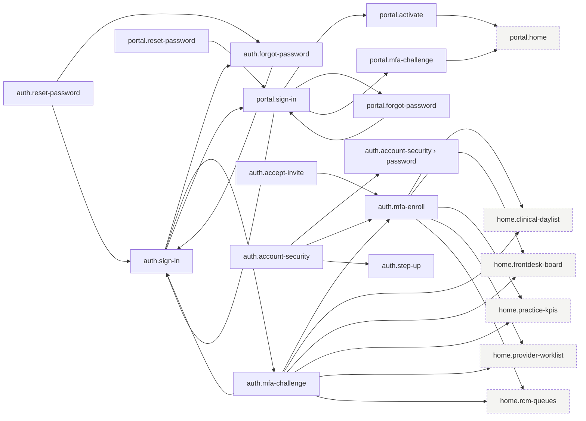

| Screen | Route | Up | Views | Reached from |
|---|---|---|---|---|
| `auth.sign-in` | `/sign-in` | — | — | `auth.forgot-password`, `auth.mfa-challenge`, `auth.reset-password`, `portal.sign-in` |
| `auth.mfa-challenge` | `/sign-in/verify` | `auth.sign-in` | — | `auth.sign-in` |
| `auth.mfa-enroll` | `/sign-in/enroll` | `auth.sign-in` | — | `auth.accept-invite`, `auth.account-security`, `auth.mfa-challenge` |
| `auth.forgot-password` | `/forgot-password` | `auth.sign-in` | — | `auth.reset-password`, `auth.sign-in` |
| `auth.reset-password` | `/reset-password/:token` | `auth.sign-in` | — | — |
| `auth.accept-invite` | `/invite/:token` | `auth.sign-in` | — | — |
| `auth.step-up` | _overlay_ | — | — | `auth.account-security`, `encounter.sign`, `reports.export` |
| `auth.account-security` | `/account/security` | — | #password | global nav |
| `portal.sign-in` | `/portal/sign-in` | — | — | `auth.sign-in`, `portal.forgot-password`, `portal.reset-password` |
| `portal.activate` | `/portal/activate/:token` | `portal.sign-in` | — | `portal.sign-in` |
| `portal.mfa-challenge` | `/portal/sign-in/verify` | `portal.sign-in` | — | `portal.sign-in` |
| `portal.forgot-password` | `/portal/forgot-password` | `portal.sign-in` | — | `portal.sign-in` |
| `portal.reset-password` | `/portal/reset-password/:token` | `portal.sign-in` | — | — |
